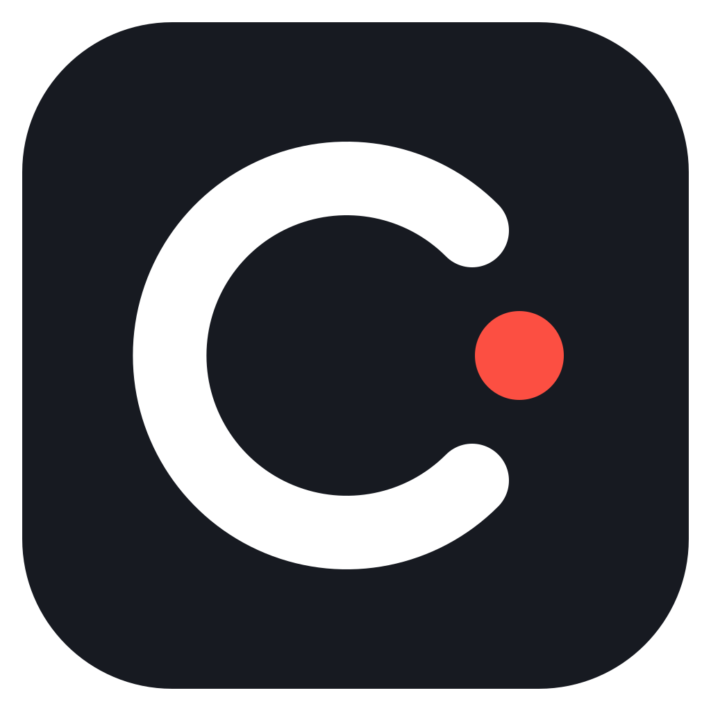

# Captor

<p align="center"></p>

Captor 是一款开源桌面录屏与视频编辑应用，适合制作演示、教程和产品介绍。录制、编辑和导出均在本地完成，无需账号或上传云端。

Captor fork 自 [Recordly](https://github.com/webadderallorg/Recordly)，基于完整的 1.4.0 源码快照。Recordly 最初 fork 自 OpenScreen。原始版权和许可证声明保留在 [LICENSE.md](LICENSE.md)。

[English](README.md) | 简体中文

## 功能

- 屏幕与窗口录制、麦克风和系统音频、摄像头叠加，以及录制倒计时。
- 自动缩放、光标平滑与效果、背景、边框、裁切、阴影和注释。
- 时间线编辑：片段、剪裁、变速、额外音频、撤销/重做，以及 `.captor` 项目保存。
- 使用 whisper.cpp 在本地生成字幕，支持字幕编辑和字幕文件导出。
- 本地 MP4/GIF 导出，画质与帧率设置、取消导出，以及取消保存后无需重新渲染的保存重试。
- 项目文件夹、原始录制素材库、明暗主题和快捷键。

上游已经停用的扩展安装与市场占位页面保持停用，不影响录制、编辑和导出。

## macOS 安装

从 [Captor Releases](https://github.com/LeeHongji/Captor/releases) 下载 Apple Silicon（arm64）或 Intel（x64）对应的 DMG，要求 macOS 14 或更新版本。打开后将 Captor 拖入“应用程序”。

当前安装版使用 ad-hoc 签名，尚未经过 Developer ID 签名和 Apple 公证。首次打开被拦截后，可在“系统设置 → 隐私与安全性”中为 Captor 选择“仍要打开”；受管理的电脑可能限制此操作。应用会检查新版本，更新前请保存工作、退出应用，再下载并替换。后续签名版将接入自动安装更新。

## 从源码运行

需要 Node.js 22.12 或更新版本，以及对应平台的构建依赖：

| 平台 | 要求 |
| --- | --- |
| macOS | macOS 14+、Xcode Command Line Tools、CMake |
| Windows | Windows 10 build 19041+、Visual Studio C++ Build Tools、CMake |
| Linux | 包括 X11/XTest/XRandR 开发库在内的原生构建依赖、CMake |

```bash
git clone https://github.com/LeeHongji/Captor.git
cd Captor
npm ci
npm run dev
```

macOS 安装依赖后也可双击 `Captor Dev.command`。`npm ci` 会安装 Electron 运行时并编译原生辅助程序。首次录制时，根据所用功能，可能需要授予屏幕录制、辅助功能、麦克风或摄像头权限。

开发数据单独保存在对应平台的 `Captor-dev` 应用数据目录，无需服务密钥或 `.env` 文件。

## 构建与检查

```bash
npm run typecheck
npm run lint
npm test
npm run i18n:check
npm run test:ui
npm run build
```

浏览器测试需要先执行 `npx playwright install chromium`。各平台打包命令为 `npm run build:mac`、`npm run build:win` 和 `npm run build:linux`。macOS 分发所需的签名和公证配置见 [RELEASING.md](RELEASING.md)。

## 本地数据与反馈

录制素材、项目和导出文件保存在本机。Captor 不包含登录、云视频库、上传目的地或反馈后台。

反馈窗口会打开系统邮件客户端，准备一封发往 **2020124002@email.szu.edu.cn** 的邮件。由用户检查并发送，也可在邮件客户端中添加附件。邮件客户端无法打开时，可直接复制反馈内容。导出错误报告只包含可预览的脱敏技术信息，不包含录制内容、文件路径或控制台日志。

## 更新与公告

打包后的应用从 [Captor GitHub Releases](https://github.com/LeeHongji/Captor/releases) 检查更新，开发版不自动更新。公告来自本仓库的 [announcements.json](announcements.json)，编写方式见 [公告说明](docs/announcements.md)。

开发与测试时可使用现有覆盖项：`CAPTOR_DISABLE_AUTO_UPDATES=1`、`CAPTOR_UPDATE_FEED_URL` 和 `CAPTOR_ANNOUNCEMENTS_URL`（设为 `off` 可关闭远程公告）。字幕模型可以在用户需要时下载，也可选择本地文件；字幕处理在本机执行。

## 贡献与许可证

可通过 Feedback 或 [GitHub Issues](https://github.com/LeeHongji/Captor/issues) 反馈问题。详见 [CONTRIBUTING.md](CONTRIBUTING.md)、[LICENSE.md](LICENSE.md) 和 [第三方声明](THIRD_PARTY_NOTICES.md)。
